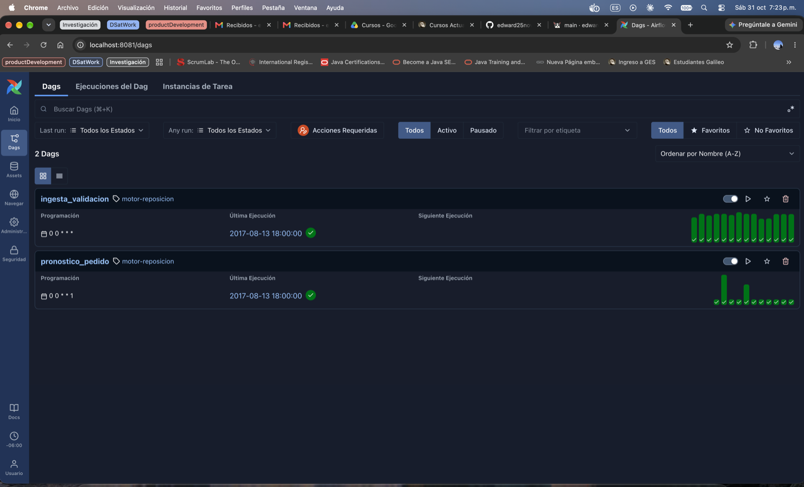

# Motor de reposición de inventario

Producto de ML que cada semana transforma las ventas que llegan a diario en un **pedido sugerido
por tienda y familia de producto** para el centro de distribución, con un pronóstico que expresa su
incertidumbre (cuantiles) y un **seguimiento** de qué tan acertadas fueron las sugerencias
anteriores. Integra **Git, DVC y Apache Airflow** para que cada resultado publicado pueda
rastrearse hasta el código, los datos y el modelo que lo produjeron.

Datos: Corporación Favorita (Kaggle *Store Sales – Time Series Forecasting*). Laboratorio 1 del
curso Product Development. Las decisiones técnicas y de producto, con sus alternativas y
justificación, están en [`DECISIONES.md`](DECISIONES.md) (D1 a D39).

**Contenido**

1. [Resultados en una mirada](#resultados-en-una-mirada)
2. [Cómo funciona](#cómo-funciona)
3. [Levantar y ejecutar el producto desde cero](#levantar-y-ejecutar-el-producto-desde-cero)
4. [Evidencia de funcionamiento](#evidencia-de-funcionamiento)
5. [Requisitos del enunciado y dónde se cumplen](#requisitos-del-enunciado-y-dónde-se-cumplen)
6. [Componentes](#componentes)
7. [Estructura del repositorio y pruebas](#estructura-del-repositorio-y-pruebas)

## Resultados en una mirada

Operación completa del 2017-06-01 al 2017-08-22 en Airflow (11 cortes semanales), con los datos
originales de Kaggle:

| Qué | Resultado |
|---|---|
| Ejecuciones en Airflow | 181 corridas de 3 DAGs, 0 fallidas |
| Comparación de modelos (backtest, 12 cortes) | GBM con cuantiles frente al baseline: WAPE 0.153 frente a 0.165, costo de negocio −13.1 %, gana 11 de 12 cortes |
| Campeón-retador en operación | GBM promovido el 2017-06-05 (−19.5 %) y el 2017-07-03 (−8.4 %); retador del 2017-07-31 descartado (mejora 0.5 % < 2 %) |
| Pronóstico publicado (9 cortes con horizonte completo) | WAPE medio 0.128, sesgo −0.2 %, cobertura P10–P90 90 % |
| Pedido sugerido (10 semanas) | Costo 802,555 frente a 1,085,265 de la regla "pedir lo vendido la semana anterior": **26 % de ahorro** |
| Situaciones de la operación | 5 archivos en cuarentena con su reenvío, 10 correcciones incorporadas, días faltantes, atrasos y fin de datos sin fallas |
| Reproducción con DVC | Cortes 2017-07-03 y 2017-08-14 reproducidos desde un clon limpio: 0 pedidos distintos |
| Verificación desde un clon limpio | Clonar, copiar los CSV, `make airflow-up` y `make operar`: 181 corridas sin fallas ni reintentos y las mismas cifras; una segunda ejecución no cambia nada ([detalle](docs/evidencias/verificacion_clon_limpio.md)) |

## Cómo funciona

```
 data/raw/kaggle/*.csv  (versionado con DVC)
        │  servicio "origen" del compose (una vez, antes de Airflow)
        ▼
 origen/historico/        carga histórica inicial
 origen/bandeja/llegada=<fecha>/<fuente>_<clave>.csv   sistema de origen simulado:
        │                 un archivo por fuente y fecha, con atrasos, correcciones e inválidos
        │  montado en solo lectura
        ▼
 ┌─────────────────────────── Airflow 3 (pool "motor", depends_on_past) ───────────────────────┐
 │ ingesta_validacion   (diario)  ingesta inmutable → validación → cuarentena / registro         │
 │ pronostico_pedido    (lunes)   ingesta → campeón-retador cada 4 semanas → features as-of     │
 │                                → pronóstico P10–P95 + pedido sugerido → publicación → DVC    │
 │ seguimiento_desempeno (diario) ingesta → lo publicado contra las ventas conocidas → reporte  │
 └──────────────────────────────────────────────────────────────────────────────────────────────┘
        ▼
 data/ingesta/  data/procesados/  models/  data/publicado/corte=<fecha>/  data/reportes/
 (todo versionado con DVC; remoto en DagsHub)
```

Tres reglas sostienen el diseño:

- **Principio fundamental:** todo lo que se usa en el corte T se lee "as-of": solo los archivos que
  llegaron hasta T (D13), cada fuente con su atraso esperado (D15) y el modelo vigente en T, nunca
  uno entrenado después (D32).
- **Inmutabilidad:** la bandeja no se modifica (montaje de solo lectura) y un corte publicado no se
  reescribe (D27); las correcciones se reflejan en el seguimiento y en los cortes siguientes.
- **Idempotencia:** cada paso se puede repetir y deja el mismo resultado (D8, D9, D27); el flujo
  soporta backfill y reprocesamiento.

## Levantar y ejecutar el producto desde cero

Requisitos: Docker Desktop (o Docker Engine con Compose v2), `make` y unos 6 GB de memoria para
Docker. No hace falta Python en el equipo ni acceso al remoto de DVC.

1. **Clonar el repositorio y colocar los CSV de Kaggle.** Descargarlos de
   <https://www.kaggle.com/competitions/store-sales-time-series-forecasting/data> y copiar estos
   cinco archivos, sin cambiarles el nombre, en `data/raw/kaggle/` (`test.csv` y
   `sample_submission.csv` no se usan):

   ```
   data/raw/kaggle/
   ├── train.csv
   ├── stores.csv
   ├── holidays_events.csv
   ├── oil.csv
   └── transactions.csv
   ```

2. **Levantar Airflow.** Construye la imagen, genera el sistema de origen (carga histórica y
   bandeja) a partir de los CSV y deja la interfaz en <http://localhost:8081> (usuario `airflow`,
   clave `airflow`):

   ```bash
   make airflow-up
   ```

3. **Ejecutar la operación** sobre el periodo de la bandeja con backfill:

   ```bash
   make operar DESDE=2017-06-01 HASTA=2017-08-22
   ```

   Crea las corridas de los tres DAGs y los activa. Cada fecha espera a la anterior; en el equipo
   de desarrollo toda la operación tarda unos 25 minutos (los entrenamientos de los lunes
   2017-06-05, 2017-07-03 y 2017-07-31 son las tareas más largas). El avance se ve en la vista
   *Grid* de cada DAG. Las fechas sin datos en el origen (por ejemplo, el lunes 2017-08-21 o la
   corrida que Airflow programa para la fecha de hoy) terminan **omitidas** (*skipped*), no en
   error.

4. **Ver los resultados:** las publicaciones en `data/publicado/corte=<fecha>/` (pronóstico,
   pedido y manifest) y el reporte de seguimiento en
   `data/reportes/seguimiento/al=2017-08-22/reporte.html`.

5. **Detener:** `make airflow-down` (conserva la base de metadatos de Airflow).

Notas:

- En Linux, `make airflow-up` crea `airflow/.env` con tu usuario (`AIRFLOW_UID`) para que los
  contenedores puedan escribir en `data/`.
- El proyecto Compose (`motor-reposicion`), la imagen, el volumen y el puerto 8081 son propios,
  para no chocar con otros Airflow del equipo (D29).
- La interfaz de Airflow muestra las fechas en la zona horaria del navegador: en Guatemala (UTC−6)
  el corte del lunes 2017-08-14 00:00 UTC aparece como 2017-08-13 18:00.
- Para volver a ejecutar desde cero: `make reiniciar` (borra la base de Airflow y todo lo generado,
  pero no los CSV de Kaggle ni el origen) y luego `make airflow-up` y `make operar`. En Linux,
  `airflow/logs/` puede pertenecer al usuario del contenedor; si `make reiniciar` no puede borrarlo,
  usar `sudo rm -rf airflow/logs`.

### Evaluar otro periodo o agregar archivos a la bandeja

El flujo opera sobre lo que haya en `origen/bandeja/`, para cualquier rango de fechas:

- **Agregar archivos:** siempre **después del primer `make airflow-up`**, copiar los archivos en
  `origen/bandeja/llegada=AAAA-MM-DD/`, donde la fecha es el día en que el archivo queda
  disponible, y ejecutar `make operar DESDE=… HASTA=…` sobre ese rango. En un clon nuevo, el primer
  `make airflow-up` genera `origen/` completo y reemplaza lo que hubiera: los archivos copiados
  antes se pierden. Después, el generador solo vuelve a reconstruir el origen si cambian los CSV de
  Kaggle o `configs/bandeja.yaml` (D30); si no, no toca la bandeja.
- **Corregir un dato ya entregado:** enviar un archivo con el mismo nombre en una carpeta de
  llegada posterior. Un archivo de una llegada ya procesada no se reprocesa aunque se cambie
  (se reporta como modificado, D12).
- **Mover el inicio de la bandeja:** cambiar `inicio_bandeja` en `configs/bandeja.yaml`, ejecutar
  `make reiniciar` y luego `make airflow-up` (el origen se regenera solo porque cambió la
  configuración) y `make operar` con el nuevo rango.

Contrato de cada archivo (las columnas de más se ignoran con advertencia; las validaciones están
en D10):

| Fuente | Nombre del archivo | Columnas | La clave es |
|---|---|---|---|
| Ventas | `ventas_AAAA-MM-DD.csv` | `date, store_nbr, family, sales` | la fecha de las ventas |
| Promociones | `promociones_AAAA-MM-DD.csv` | `date, store_nbr, family, onpromotion` | la fecha de la promoción |
| Transacciones | `transacciones_AAAA-MM-DD.csv` | `date, store_nbr, transactions` | la fecha de las transacciones |
| Petróleo | `petroleo_AAAA-MM-DD.csv` | `date, dcoilwtico` (puede ser nulo) | la fecha del precio |
| Feriados | `feriados_AAAA-MM.csv` | `date, type, locale, locale_name, description, transferred` | el mes del calendario |
| Tiendas | `tiendas_AAAA-MM-DD.csv` | `store_nbr, city, state, type, cluster` | el día del anuncio |

Qué pasa en cada situación:

- **Archivo inválido** (columnas faltantes, tipos, negativos, duplicados, fecha distinta a la
  clave): va a cuarentena y se espera el reenvío; la ingesta no falla.
- **Archivo con nombre fuera del contrato:** se ignora y se lista en `no_reconocidos` del reporte
  de ingesta.
- **Tienda o familia nueva:** sus filas se guardan con advertencia; la tienda se pronostica cuando
  llega su registro en `tiendas_…` y la familia, como categoría no vista.
- **Ventas atrasadas más de 4 días al corte:** el corte no se publica, queda registrado con su
  motivo en `data/procesados/calidad/` y en el seguimiento, y el lunes siguiente se vuelve a
  intentar.
- **Faltan promociones o transacciones:** se pronostica igual y el reporte de calidad lo advierte;
  la variable queda vacía para esos días. Con los datos de Kaggle esto ocurre, de forma esperada, en los cortes
  2017-08-07 y 2017-08-14: `train.csv` termina el 2017-08-15 y `test.csv`, que trae las promociones
  posteriores, queda fuera del laboratorio por el enunciado.
- **Total diario de una tienda muy lejos de lo habitual:** advertencia de atípico (D38).
- **Fechas posteriores a la última llegada de la bandeja:** las corridas se omiten (D36).

## Evidencia de funcionamiento

### Ejecuciones en Airflow

Corrida completa del 2017-06-01 al 2017-08-22 (capturas en [`docs/evidencias/airflow/`](docs/evidencias/airflow/)):

| Captura | Muestra |
|---|---|
| [01-dags](docs/evidencias/airflow/01-dags.png) | Los tres DAGs y su programación |
| [02-ejecuciones-todas](docs/evidencias/airflow/02-ejecuciones-todas.png) | Las 181 ejecuciones, todas exitosas |
| [03-ejecuciones-pronostico-pedido](docs/evidencias/airflow/03-ejecuciones-pronostico-pedido.png) | Los 11 lunes, más el 2017-08-21 y la corrida programada de 2026, omitidos por falta de datos |
| [04-ejecuciones-ingesta-validacion](docs/evidencias/airflow/04-ejecuciones-ingesta-validacion.png) | Las 84 ingestas diarias |
| [05-ejecuciones-seguimiento-desempeno](docs/evidencias/airflow/05-ejecuciones-seguimiento-desempeno.png) | Los 84 seguimientos diarios |



### Cómo reaccionó el flujo a las situaciones de la operación

Extractos de los logs de las tareas en Airflow (`airflow/logs/`) y de los reportes de ingesta:

| Situación | Fecha | Reacción | Log |
|---|---|---|---|
| Archivo de ventas con valores negativos | llega el 2017-07-02 | Cuarentena; la tarea termina bien y no se usa el archivo (D10, D11) | `ingesta 2017-07-02: … 1 en cuarentena` · `ventas 2017-07-01: ["sales: 22 valores negativos"]` |
| Reenvío del archivo válido | 2017-07-04 | Se registra como reenvío y se usa desde ese día (D12) | `ingesta 2017-07-04: … {'nuevo': 4, 'reenvio': 1}; 0 en cuarentena` |
| Archivo con filas duplicadas | llega el 2017-07-08 | Cuarentena | `ventas 2017-07-07: ["34 filas duplicadas por date, store_nbr, family"]` |
| Corrección de ventas ya usadas | 2017-07-06 | Se registra como corrección; el seguimiento la incorpora, lo publicado no cambia (D12, D27, D35) | `ingesta 2017-07-06: … {'correccion': 1, 'nuevo': 4}` |
| Falta un día de ventas al pronosticar | corte 2017-07-03 | El pronóstico sigue con los días disponibles y lo reporta (D17) | `preparacion 2017-07-03: … días sin ventas en la última semana: ['2017-07-01']` |
| Retador que no mejora lo suficiente | corte 2017-07-31 | Se descarta; sigue el modelo vigente (D23) | `entrenar 2017-07-31: gbm-2017-07-31 vs gbm-2017-07-03: se descarta: mejora de costo 0.5% < 2%` |
| Retador que sí mejora | corte 2017-07-03 | Se promueve | `entrenar 2017-07-03: gbm-2017-07-03 vs gbm-2017-06-05: se promueve: mejora de costo 8.4%, gana 100% de los cortes, cobertura 88.8%` |
| Fin de los datos del origen | corte 2017-08-21 y corrida de 2026 | Omitidos, no fallidos (D36) | `2017-08-21: la bandeja no tiene ventas posteriores al 2017-08-15: fin de la operación simulada, se omite` |
| Entrenamiento sin heartbeat por uso de CPU | corte 2017-07-31 | El reintento lo completó; luego se limitaron los hilos (D37) | `Detected a task instance without a heartbeat` → `Marking task as UP_FOR_RETRY` |

En total, la bandeja simulada trajo 22 incidentes (D7): 5 archivos inválidos, 10 correcciones y 7
atrasos. La ingesta detectó los 5 inválidos y las 10 correcciones sin leer la "hoja de respuestas"
del simulador.

### Comparación de modelos

Validación de origen móvil con los mismos 12 cortes y las mismas filas de entrenamiento para ambos
modelos (snapshot 2017-06-05, cortes del 2017-02-27 al 2017-05-15; D22). Detalle en
[`docs/evidencias/modelos/`](docs/evidencias/modelos/).

| Modelo | WAPE | Sesgo | RMSLE | Pinball | Cobertura P10–P90 | Costo de negocio |
|---|---|---|---|---|---|---|
| Baseline (mismo día de la semana, 4 semanas) | 0.165 | −3.4 % | 0.587 | 0.060 | 80.6 % | 4,512,780 |
| **GBM con cuantiles** | **0.153** | −3.3 % | **0.497** | 0.064 | 85.2 % | **3,920,847** |

Decisiones del proceso campeón-retador en la operación ([`registro_modelos.json`](docs/evidencias/modelos/registro_modelos.json)):

| Versión | Decisión | Motivo |
|---|---|---|
| `baseline-2017-06-05` | vigente inicial | no había modelo vigente: el baseline es el piso |
| `gbm-2017-06-05` | promovido | mejora de costo 19.5 %, gana 100 % de los cortes, cobertura 87.0 % |
| `gbm-2017-07-03` | promovido | mejora de costo 8.4 %, gana 100 % de los cortes, cobertura 88.8 % |
| `gbm-2017-07-31` | descartado | mejora de costo 0.5 % < 2 % |

### Seguimiento del desempeño

Reporte al 2017-08-22 (con las 10 correcciones de ventas que llegaron):
[`reporte.html`](docs/evidencias/seguimiento/reporte.html) y sus CSV en
[`docs/evidencias/seguimiento/`](docs/evidencias/seguimiento/).

| Grupo | Unidades pedidas | Unidades vendidas | Nivel de servicio | Objetivo | Costo del pedido | Costo de la referencia | Ahorro |
|---|---|---|---|---|---|---|---|
| No perecederos | 45,707,150 | 39,542,310 | 96.0 % | 85.7 % | 460,148 | 737,008 | 37.6 % |
| Perecederos | 20,172,320 | 19,629,160 | 61.2 % | 54.5 % | 342,407 | 348,258 | 1.7 % |
| **Total** | 65,879,470 | 59,171,440 | 86.5 % | 77.2 % | **802,555** | **1,085,265** | **26.0 %** |

Nivel de servicio: proporción de tiendas y familias en que la venta de la semana no superó lo
pedido; el objetivo es la proporción crítica de los costos de `configs/negocio.yaml`. La
referencia imita al gerente sin modelo: pedir lo vendido la semana anterior. El pedido cubre por
encima del objetivo en los no perecederos (D25 explica por qué esa sobrecobertura es la de menor
costo); en perecederos el ahorro frente a la referencia es pequeño, y en 3 de las 10 semanas la
referencia fue más barata en el total.

### Reproducción de un pronóstico pasado con DVC

Desde un clon limpio del repositorio se recuperó la publicación del corte 2017-07-03, se volvió
al código exacto que la produjo (el `git_commit` de su manifest) y a los datos y modelos de su
versión, y se recalculó. Antes de `dvc pull` hay que configurar las credenciales de DagsHub (ver
[Versionado de datos](#versionado-de-datos-dvc)). Salida completa en
[`docs/evidencias/reproduccion_dvc.txt`](docs/evidencias/reproduccion_dvc.txt):

```text
$ git clone https://github.com/edward25nov/motor-reposicion.git && cd motor-reposicion

# 1. Qué código y qué datos produjeron la publicación del corte 2017-07-03
$ git checkout 75e1005          # commit que fija con DVC los resultados de la corrida completa
$ dvc pull data/publicado.dvc
$ python -c "import json; m = json.load(open('data/publicado/corte=2017-07-03/manifest.json')); print(m['git_commit'], m['modelo'], m['datos'])"
085d363fb973c238ace04523e694a12206f113c0 {'version': 'gbm-2017-07-03', 'md5': '1a8457911a9e9bd431bd3ec4a053c529'} {'hash': '6e9ab3246708140dae0fde34ed85a70d', 'archivos': 129, 'ultima_llegada': '2017-07-03'}

# 2. Volver al código de ese commit y traer los datos y modelos de su versión
$ git checkout 085d363
$ git checkout 75e1005 -- data/ingesta.dvc models.dvc data/publicado.dvc
$ dvc pull data/ingesta.dvc models.dvc data/publicado.dvc
678 files fetched and 676 files added

# 3. Reproducir el pronóstico y el pedido publicados
$ make reproducir CORTE=2017-07-03
{
  "corte": "2017-07-03",
  "modelo": "gbm-2017-07-03",
  "misma_huella_de_datos": true,
  "filas_iguales": true,
  "max_dif_pronostico": 3.637978807091713e-12,
  "pedidos_distintos": 0,
  "unidades_publicadas": 6589843.0,
  "unidades_reproducidas": 6589843.0,
  "reproducido": true
}
```

El corte 2017-08-14 también se reprodujo (0 pedidos distintos). La diferencia máxima del orden de
10⁻¹² viene de que la publicación se calculó en el contenedor de Airflow (Linux) y la reproducción
en macOS; ningún pedido cambia. La huella de datos coincide aunque después del 2017-07-03 llegaron
correcciones: la lectura as-of usa solo lo que había llegado al corte (D13, D27).

## Requisitos del enunciado y dónde se cumplen

| Requisito | Dónde | Decisiones |
|---|---|---|
| Pronóstico diario por tienda y familia con incertidumbre | `src/inventario/modelos/gbm.py` (P10 a P95), `data/publicado/*/pronostico.parquet` | D14, D20 |
| Pedido sugerido con costos en configuración versionada | `configs/negocio.yaml`, `src/inventario/publicacion/pedido.py`; prueba `test_cambiar_los_costos_cambia_el_pedido_sin_tocar_codigo` | D21, D25, D26 |
| Seguimiento del desempeño | DAG `seguimiento_desempeno`, `src/inventario/seguimiento/` | D35 |
| Carga histórica y bandeja construidas desde Kaggle | `src/inventario/origen/`, `configs/bandeja.yaml` | D4 a D8 |
| Fuentes con distinta frecuencia y anticipación, correcciones | `configs/bandeja.yaml`, `configs/preparacion.yaml` | D6, D7, D15 |
| La bandeja se lee pero nunca se modifica | montaje `:ro` en `airflow/docker-compose.yaml`; prueba `test_la_bandeja_no_se_modifica` | D29 |
| Principio fundamental (solo información disponible al emitir) | `src/inventario/ingesta/vigente.py`, `registro.vigente_al`; pruebas `test_ninguna_feature_ve_ventas_posteriores_al_corte` y `test_un_corte_no_usa_un_modelo_entrenado_despues` | D13, D15, D18, D32 |
| Repositorio en GitHub con código, configuración, DAGs y pruebas | este repositorio | — |
| Ramas y Pull Requests; rama principal protegida | PRs #1 a #10; `main` exige PR y que pase `pytest` | — |
| `pytest` en cada Pull Request con GitHub Actions | `.github/workflows/tests.yml` | — |
| Archivo de contexto para el agente | `CLAUDE.md` | — |
| Ningún dato ni modelo en Git; DVC con remoto | `.gitignore`, punteros `*.dvc`, remoto DagsHub | D1, D2 |
| Versionar entrada, procesados, modelos y pronósticos | `data/raw/kaggle.dvc`, `data/ingesta.dvc`, `data/procesados.dvc`, `models.dvc`, `data/publicado.dvc` (y `data/reportes.dvc`) | D33 |
| Reproducir un pronóstico pasado desde su versión de código y datos | `make reproducir`, manifest por publicación; [evidencia](#reproducción-de-un-pronóstico-pasado-con-dvc) | D27 |
| Airflow 3 con Docker Compose | `airflow/` (Airflow 3.3.2) | D29, D30 |
| DAGs de ingesta y validación, preparación, pronóstico y pedido, seguimiento | `dags/` | D31 |
| Tareas idempotentes | pruebas `test_es_idempotente`, `test_preparar_un_corte_es_idempotente`, `test_una_publicacion_no_se_modifica` | D8, D9, D27 |
| Datos inválidos detenidos; situaciones esperadas sin fallas | cuarentena en la ingesta, cortes sin datos suficientes omitidos con su motivo, guardas `en_operacion`, advertencias de calidad; [evidencia](#cómo-reaccionó-el-flujo-a-las-situaciones-de-la-operación) | D10, D11, D17, D36, D38 |
| Backfill y reprocesamiento de datos corregidos | `make operar`; corrección detectada y reflejada en el seguimiento | D9, D12, D32, D35 |
| Lógica en módulos con pruebas; los DAGs solo orquestan | `src/inventario/` (96 pruebas en `tests/`) | — |
| Baseline simple | `src/inventario/modelos/baseline.py` | D19 |
| Modelo de ML que mejora al baseline; deep learning justificado | `src/inventario/modelos/gbm.py`; [comparación](#comparación-de-modelos) | D20, D22 |
| Validación temporal igual para todos los modelos | `src/inventario/modelos/evaluacion.py`, `backtest.py` | D22 |
| Métricas técnicas y métrica de negocio desde la configuración | `src/inventario/modelos/metricas.py` | D21 |
| Criterio explícito de reemplazo del modelo vigente | `src/inventario/modelos/promocion.py`, `configs/modelo.yaml` | D23, D24 |
| `README.md` y `DECISIONES.md` | este archivo y [`DECISIONES.md`](DECISIONES.md) | — |
| Evidencia: Airflow, comparación de modelos y seguimiento | [Evidencia de funcionamiento](#evidencia-de-funcionamiento) | — |
| Tag `entrega-lab1` | se crea al cerrar la entrega | — |

## Componentes

Cada paso se puede ejecutar también fuera de Airflow (ver [Comandos sin Docker](#comandos-sin-docker)).

### Versionado de datos (DVC)

Los datos de entrada, los datos de ingesta y procesados, los modelos, las publicaciones y los
reportes se versionan con DVC. El remoto `origin` está en DagsHub:
`https://dagshub.com/edward25nov/motor-reposicion.dvc`. El DAG semanal ejecuta `dvc add` al final
de cada corte y `dvc push` si hay credenciales (D33).

**Para evaluar el producto no hace falta acceso al remoto:** todo se reconstruye desde los CSV de
Kaggle. Para comprobar que los CSV colocados son los originales, sin acceso al remoto:

```bash
dvc add data/raw/kaggle && git diff --exit-code data/raw/kaggle.dvc
```

Si no muestra diferencias, su hash coincide con la versión registrada. Sin DVC instalado en el
equipo, la misma comprobación se hace dentro del contenedor (con Airflow levantado):

```bash
docker compose -f airflow/docker-compose.yaml exec airflow-scheduler bash -c "cd /opt/motor && dvc add data/raw/kaggle" \
  && git diff --exit-code data/raw/kaggle.dvc
``` (`dvc status` no sirve en un
clon nuevo: sin caché local responde "not in cache" tanto con los archivos originales como con
otros; se comprobó.)

DagsHub exige iniciar sesión incluso en repositorios públicos, así que `dvc pull` requiere una
cuenta con acceso al repositorio:

```bash
dvc remote modify origin --local auth basic
dvc remote modify origin --local user <usuario-dagshub>
dvc remote modify origin --local password <token-dagshub>
dvc pull
```

### Sistema de origen simulado

`make origen` construye `origen/historico/` y `origen/bandeja/llegada=<AAAA-MM-DD>/` a partir de
los CSV de Kaggle (en Airflow lo hace el servicio `origen`). La carpeta `llegada=` es el día en que
el archivo está disponible; un archivo con la misma fuente y clave en una llegada posterior es una
corrección o un reenvío. Parámetros en `configs/bandeja.yaml` (D4 a D8).

### Ingesta y validación

`make ingesta CORTE=2017-07-15` procesa en orden de llegada todo lo pendiente hasta el corte:
copia inmutable en `data/ingesta/recibidos/`, validación, datos válidos en `validos/`, cuarentena
de los inválidos y registro en `registro.db` con el tipo de cada archivo (nuevo, corrección,
reenvío, repetido). Reporte por corte en `data/ingesta/reportes/` (D9 a D13).

### Preparación de datos

`make preparar CORTE=2017-07-17` arma la tabla de features del corte con los datos tal como se
conocían ese día: `data/procesados/features/corte=<fecha>.parquet` (1,782 series × 14 días) y un
reporte de calidad. Si las ventas están demasiado atrasadas se detiene con `DatosInsuficientes`
(D14 a D18).

### Modelos

```bash
make backtest SNAPSHOT=2017-06-05   # compara baseline y GBM con validación de origen móvil
make entrenar SNAPSHOT=2017-06-05   # entrena un retador y aplica la regla de reemplazo
```

El backtest deja sus métricas en `data/reportes/backtest/`; cada versión entrenada queda en
`models/` y su decisión en `models/registro.json`. Configuración en `configs/modelo.yaml` y costos
en `configs/negocio.yaml` (D19 a D24, D34).

### Pronóstico y pedido sugerido

```bash
make publicar CORTE=2017-07-17     # requiere la preparación del corte y un modelo vigente
make reproducir CORTE=2017-07-17   # recalcula y compara con lo publicado
```

Cada corte se publica una sola vez en `data/publicado/corte=<fecha>/`: `pronostico.parquet`,
`pedido.csv` (semana de miércoles a martes) y `manifest.json` con el commit, el modelo, la
configuración y la huella de los datos usados (D25 a D28).

### Seguimiento del desempeño

`make seguimiento FECHA=2017-08-22` compara cada publicación con las ventas conocidas a esa fecha
y escribe `data/reportes/seguimiento/al=<fecha>/` con tres CSV y `reporte.html` (D35).

### Comandos sin Docker

Con Python 3.12 o superior:

```bash
python -m venv .venv && .venv/bin/pip install -r requirements-dev.txt
make test PYTHON=.venv/bin/python
make origen PYTHON=.venv/bin/python
make ingesta CORTE=2017-07-17 PYTHON=.venv/bin/python
make entrenar SNAPSHOT=2017-06-05 PYTHON=.venv/bin/python
make preparar CORTE=2017-07-17 PYTHON=.venv/bin/python
make publicar CORTE=2017-07-17 PYTHON=.venv/bin/python
make seguimiento FECHA=2017-08-22 PYTHON=.venv/bin/python
```

Si la ruta del repositorio tiene espacios, usa `PYTHON=python` con el entorno virtual activado
(`source .venv/bin/activate`).

## Estructura del repositorio y pruebas

```
airflow/          docker-compose.yaml, Dockerfile y .env.example de Airflow 3.3.2
configs/          bandeja.yaml, preparacion.yaml, modelo.yaml, negocio.yaml
dags/             ingesta_validacion, pronostico_pedido, seguimiento_desempeno (solo orquestan)
src/inventario/
  origen/         sistema de origen simulado (carga histórica y bandeja)
  ingesta/        validación, registro, ingesta por corte y lectura as-of
  preparacion/    calendario de feriados, features por corte, conjunto de entrenamiento
  modelos/        baseline, GBM, métricas, regla de promoción, backtest, campeón-retador, registro
  publicacion/    pedido sugerido, publicación con manifest y reproducción
  seguimiento/    métricas de lo publicado y reporte HTML
  operacion.py    cuándo reentrenar y guardas de fin de operación
  versionado.py   dvc add / push desde el flujo
tests/            96 pruebas con pytest (datos sintéticos con la forma de Kaggle)
docs/evidencias/  capturas de Airflow, comparación de modelos, seguimiento y reproducción
data/, models/    generados por el flujo; en Git solo sus punteros .dvc
CLAUDE.md         reglas del proyecto para el agente de programación
DECISIONES.md     decisiones técnicas y de producto (D1 a D39)
```

Las pruebas corren en cada Pull Request con GitHub Actions y localmente con `make test`. Cubren,
entre otras cosas: que ninguna feature use ventas posteriores al corte, que un corte no use un
modelo entrenado después, que la bandeja no se modifique, la idempotencia de la ingesta, la
preparación y la publicación, la detección de correcciones y reenvíos, la regla de reemplazo, la
inmutabilidad de lo publicado y su reproducción.
